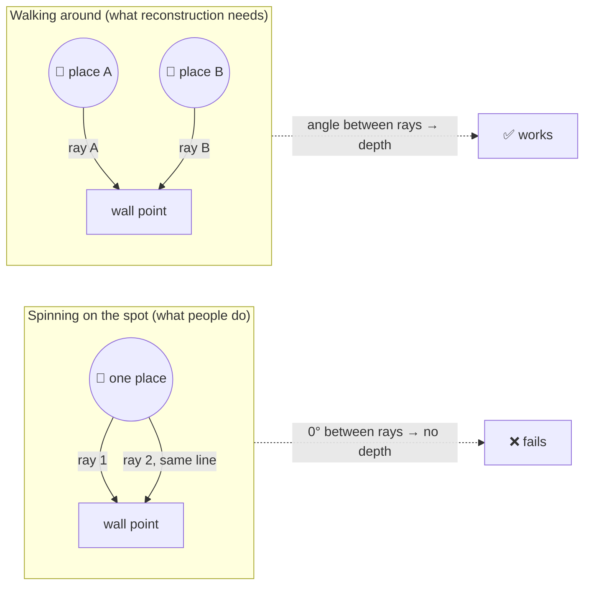
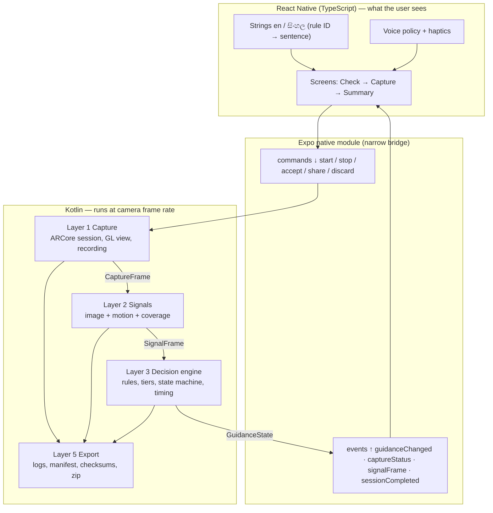
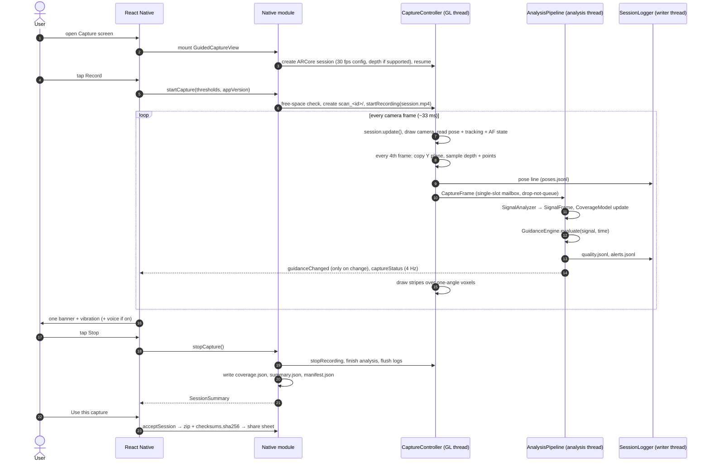
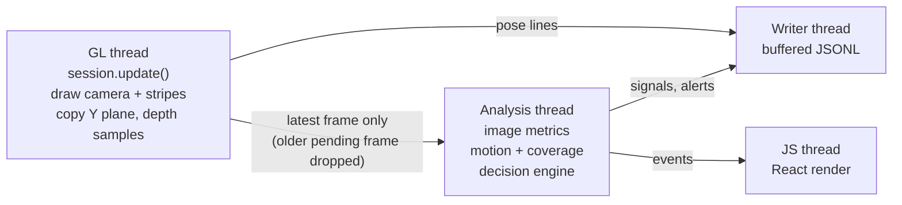
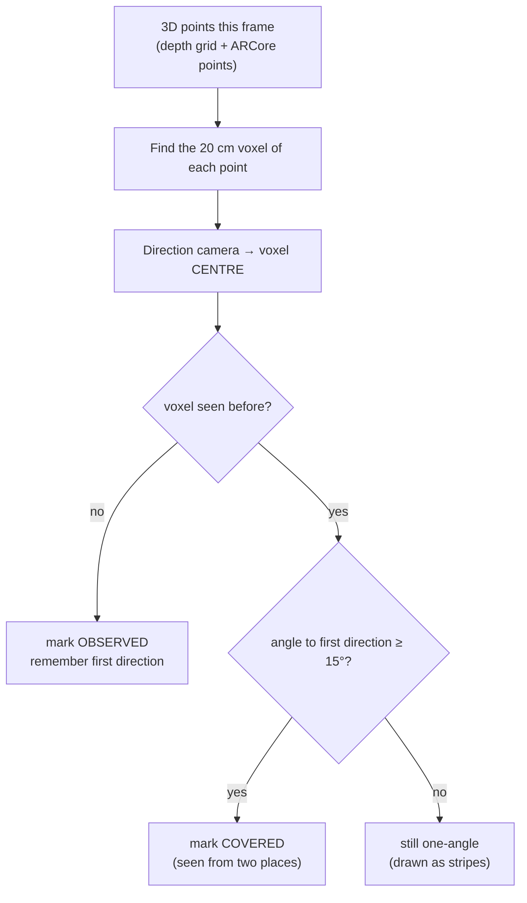
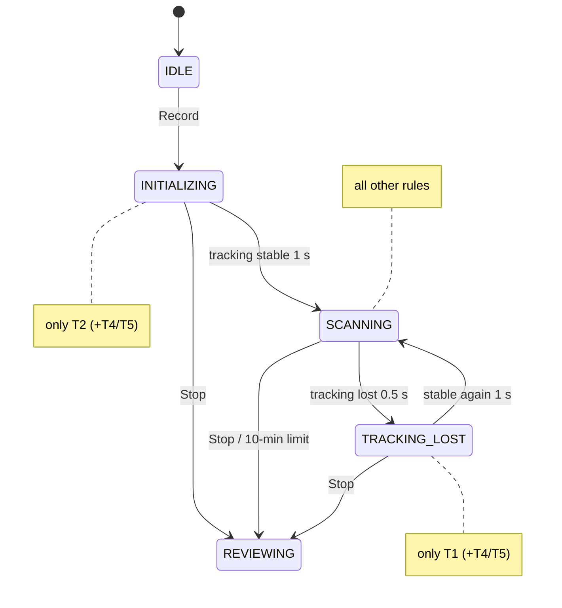
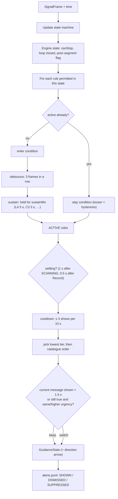
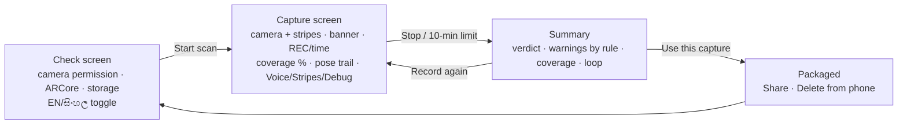
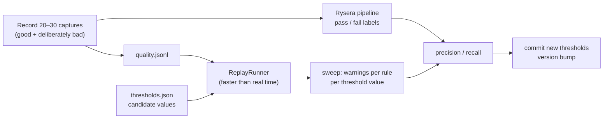

# Guided Capture — the complete guide

This guide explains the whole system step by step, from "why does the app exist" down to the
formula behind every warning. Read it top to bottom once; afterwards use the table of contents.
Diagrams are Mermaid and render on GitHub.

1. [The problem in one picture](#1-the-problem-in-one-picture)
2. [The system at a glance](#2-the-system-at-a-glance)
3. [What happens when you press Record](#3-what-happens-when-you-press-record)
4. [Threads: who does what, and why](#4-threads-who-does-what-and-why)
5. [Layer 1 — capture: what is read from ARCore](#5-layer-1--capture-what-is-read-from-arcore)
6. [Layer 2 — signals: turning frames into numbers](#6-layer-2--signals-turning-frames-into-numbers)
7. [The coverage model: measuring parallax, not directions](#7-the-coverage-model-measuring-parallax-not-directions)
8. [Layer 3 — the decision engine](#8-layer-3--the-decision-engine)
9. [The complete rule catalogue (27 rules)](#9-the-complete-rule-catalogue-27-rules)
10. [Layer 4 — the interface](#10-layer-4--the-interface)
11. [Layer 5 — recording, logs and the export package](#11-layer-5--recording-logs-and-the-export-package)
12. [Calibration with offline replay](#12-calibration-with-offline-replay)
13. [Security and privacy](#13-security-and-privacy)
14. [How it is tested](#14-how-it-is-tested)
15. [Recipes: changing the system safely](#15-recipes-changing-the-system-safely)
16. [Limits and what comes next](#16-limits-and-what-comes-next)

---

## 1. The problem in one picture

A 3D reconstruction pipeline recovers depth by **triangulation**: the same point must be seen
from two *different places*. Untrained people scan a room the way they take a panorama: they
stand in the middle and turn. Every frame overlaps nicely, so the video *looks* fine, but there is
no parallax, so nothing can be triangulated and the reconstruction fails.



The app watches the capture as it happens and corrects behaviour **at the moment it occurs**,
with one short instruction at a time. Fixing it later means another visit to the house.

---

## 2. The system at a glance



**Why this split?** ARCore has no JavaScript API, and the per-frame loop runs 30 times a second
on mid-range phones, so everything that touches frames stays in Kotlin. React Native owns screens,
text and the transfer workflow, which change often and can later be shared with iOS.

**The rule that keeps it testable:** the packages `core`, `signals`, `guidance`, `replay` and
`export` contain no Android, ARCore or React Native types. They compile on a plain JVM
(`tools/engine-tests`), so the whole decision logic is unit-tested and replayed on a laptop.

```
modules/guided-capture/android/src/main/java/lk/transitionx/capture/
├── core/      Contracts.kt — CapturePose, CaptureFrame, SignalFrame, GuidanceState, rule IDs
├── signals/   ImageMetrics, MotionTracker, CoverageModel, SignalAnalyzer
├── guidance/  Rules, Thresholds, SessionStateMachine, GuidanceEngine
├── replay/    JsonLite, LogCodec, ReplayRunner (offline replay + threshold sweep)
├── export/    ExportDocs (manifest/coverage/summary), PackageIntegrity (SHA-256 + zip)
└── android/   CaptureController, GuidedCaptureView, BackgroundRenderer, CoverageOverlayRenderer,
               FrameSampler, AnalysisPipeline, SessionLogger, PackageExporter, Speech, Module
```

---

## 3. What happens when you press Record



---

## 4. Threads: who does what, and why



| Rule | Reason |
|---|---|
| Image analysis never runs on the GL thread | it would stall `session.update()` and drop the frame rate |
| Frames are dropped, never queued | a queue turns a CPU spike into permanently late guidance |
| Logging is buffered on its own thread | per-frame file I/O would dominate the frame budget |
| The engine never reads a clock | deterministic, testable, and replayable faster than real time |

Measured on the Galaxy A55 (first real capture): **30.0 fps**, frame interval p95 33.4 ms, max 46 ms,
2504 poses → 2504 analysed frames (nothing dropped).

---

## 5. Layer 1 — capture: what is read from ARCore

| Every frame | Every 4th frame (sampled) |
|---|---|
| Camera pose (position + quaternion) | Y plane of the CPU image (640×480 on the A55) |
| Tracking state + failure reason | Depth image (if supported): 24×18 grid → world points + centre distance |
| Autofocus state (`CONTROL_AF_STATE`) | Confident ARCore feature points (≤ 200) |
| Point-cloud size | |
| Camera intrinsics (once) | |

Camera configuration: the highest **CPU image** resolution up to 1280×720 at 30 fps, because the
ARCore Recording API stores the CPU image stream (the first capture was 640×480 even though the
display texture was 1080p). The chosen size is written to the manifest.

---

## 6. Layer 2 — signals: turning frames into numbers

### 6.1 Image signals (160×120 box-averaged copy of the Y plane)

| Signal | How it is computed | Catches |
|---|---|---|
| `brightness` | mean of Y (Y *is* perceptual luminance; no RGB conversion) | L1 too dark |
| `clippedHigh` / `clippedLow` | % pixels > 250 / < 5 | L2 too bright |
| `blurScore` | variance of the 3×3 Laplacian | (raw detail; legacy) |
| `textureFraction` | share of 8×8 blocks with std-dev > 8 | S1 blank wall |
| `sharpness` | Laplacian variance ÷ (mean 8×8 block variance + 1) | L3 motion blur, L4 lens |
| `specularPercent` | % blocks with a pixel ≥ 250 while the block mean < 170 | S4 glare / glass |

Why `sharpness` instead of raw Laplacian variance? A plain ceiling is sharp but has little detail,
so raw variance called it "blurry". Dividing by block contrast asks "is the detail that exists
crisp?". On the real capture the median was **0.67 while turning > 30°/s and 1.93 while still**.

### 6.2 Motion signals (from poses)

| Signal | How | Catches |
|---|---|---|
| `angularVelocity`, `linearVelocity` | change over a 200 ms window | G1 turn too fast |
| `angularAccel` | change of angular velocity over 200 ms | G5 jerky |
| `windowRotationDeg` / `windowTranslationM` | rotation accumulated (100 ms steps) vs net translation over 2 s | G4 spinning |
| `jitterDegPerSec` | full-rate rotation − decimated rotation, per second | G2 shake |
| keyframes, `baseline`, `pathLengthM` | a keyframe every 0.15 m travelled | G3 keep moving, C6 |
| `distanceFromStartM`, `maxDistanceFromStartM` | from the first tracked pose | C5 loop, C6 |

While tracking is lost the pose history is cleared, so a relocalisation jump never looks like a
violent motion.

### 6.3 Depth and focus

* `distanceToSurface`: median depth in the centre third of the depth image (S2/S3). If the phone
  has no Depth API the value is **absent**, and the rules stay silent instead of guessing.
* `afState`: Camera2 autofocus state (1 / 3 = scanning) for L5.

---

## 7. The coverage model: measuring parallax, not directions

The obvious coverage metric ("how many directions have I looked in") is **wrong**: it is
highest for the user who spins in place, the worst possible capture. The app measures what
reconstruction needs instead.



Because the direction is taken to the voxel **centre**, turning on the spot never changes it.
Tested on a synthetic 4 m room: spinning 360° → many observed voxels, **0 % covered**; walking a
1 m circle → **> 40 % covered** (`CoverageModelTest`).

The same model answers the navigation questions:

| Rule | Question | Measured as |
|---|---|---|
| C1 | Which part of the room have I never looked at? | 12 azimuth bins of viewing direction; largest unseen arc ≥ 60°, turn ≥ 45° |
| C2 | Have I looked up and down? | pitch beyond ±30° ever seen |
| C3 | Is what I see now seen from one angle only? | voxels in a 30° cone; ≥ 70 % one-angle for 3 s |
| C4 | Is a room corner missing? | corners of the observed floor footprint with no voxel within 0.75 m |
| C6 | Is it good enough to stop? | time + path + keyframes + extent, **and** ≥ 50 % covered once ≥ 60 voxels are measured |

Method reported honestly: `VOXEL_GRID` (depth used), `POINTCLOUD_ANGULAR` (ARCore points only),
or `POSE_TRAIL` (nothing measured). The percentage is shown only for the first two, labelled
"Seen from 2+ angles".

**"Erase the stripes"** (IntelliCap, ISMAR 2025): one-angle voxels are drawn as pink-and-white
striped discs over the camera image. Walk to see them from a second place and they disappear.

---

## 8. Layer 3 — the decision engine

Several rules are true at the same time in normal use. Showing all of them trains the user to
ignore the screen, so the engine shows **exactly one**, and keeps it stable.

### 8.1 Session state machine



The permitted set is a table owned by the state machine, so a rule added later cannot "forget"
to check the state.

### 8.2 One evaluation, step by step



### 8.3 Priority tiers

| Tier | Meaning | Rules |
|---|---|---|
| 0 | Session blocking | T1 T2 T4 T5 |
| 1 | Structurally unusable | G4 |
| 2 | Data being destroyed | G1 L1 L3 S1 |
| 3 | Data degraded | G2 L2 T6 S2 T7 |
| 4 | Efficiency / device / surface | G5 L4 L5 S3 T3 S4 |
| 5 | Completeness | G3 C3 C5 |
| 6 | Navigation | C1 C2 C4 |
| 7 | Positive | C6 |

Severity follows the tier (0–1 critical, 2–3 warning, 4–7 info) and sets colour, vibration and
voice. A message that is still true is not replaced by another of the same tier (found on the
first real capture, where S1 and L3 alternated every 1.5 s).

---

## 9. The complete rule catalogue (27 rules)

Thresholds are in `config/thresholds.v1.json` (version `1.2-phase23`). "Real" = observed on the
Galaxy A55 capture; "Synthetic" = verified by unit test only.

| ID | Message (EN) | Trigger | Tier | Phase | Evidence |
|---|---|---|---|---|---|
| T1 | Tracking lost — go back to a scanned area (+ reason) | state TRACKING_LOST | 0 | 1 | Synthetic |
| T2 | Move the phone slowly side to side | state INITIALIZING | 0 | 1 | Real |
| T4 | Another app is using the camera | ARCore CAMERA_UNAVAILABLE | 0 | 1 | Synthetic |
| T5 | Something went wrong — restart | ARCore BAD_STATE | 0 | 1 | Synthetic |
| G4 | Walk around the room, don't spin | rotation > 30° with < 0.10 m in 2 s | 1 | 1 | Real |
| G1 | Turn more slowly | angular velocity > 45 °/s (exit 35) | 2 | 1 | Real |
| L1 | Too dark — turn on a light | brightness < 40 (exit 50) or ARCore INSUFFICIENT_LIGHT | 2 | 1 | Real |
| L3 | Blurry — move more slowly | sharpness < 1.0 (exit 1.3) **while moving** | 2 | 1 | Real |
| S1 | Blank wall — look at corners / objects | texture < 0.15 (exit 0.25) in good light, or INSUFFICIENT_FEATURES | 2 | 1 | Real (false alarms removed) |
| G2 | Hold the phone steady | jitter > 10 °/s (exit 6) while < 0.3 m/s | 3 | 1 | Synthetic |
| L2 | Too bright — avoid the window | clipped > 15 % (exit 10 %) | 3 | 1 | Synthetic |
| T6 | You're moving too fast | ARCore EXCESSIVE_MOTION (grace window) | 3 | 1 | Synthetic |
| S2 | Too close — step back | depth < 0.5 m (exit 0.6) | 3 | 2 | Synthetic |
| T7 | That part was poor — film it again | ≥ 60 % of 5 s lost/dark/blurred, then 1 s good; one-shot, ≥ 20 s apart | 3 | 2 | Real (once, after the dark spell) |
| G5 | Move smoothly | angular acceleration > 400 °/s² (exit 250) | 4 | 2 | Synthetic |
| L4 | Clean the camera lens | still + good light + detailed + sharpness < 1.0, focus settled, 5 s | 4 | 2 | Synthetic |
| L5 | Hold still — camera is focusing | AF scanning + soft image, 1 s | 4 | 2 | Synthetic |
| S3 | Too far — move closer | depth > 4.0 m (exit 3.5) | 4 | 2 | Synthetic |
| T3 | Phone is hot — finish soon | thermal ≥ SEVERE | 4 | 2 | Synthetic |
| S4 | Mirror or glass — move slowly (experimental) | glare blocks 2–15 %, not a window, 1.5 s | 4 | 3 | Synthetic |
| G3 | Keep moving forward | no new keyframe for 3 s | 5 | 1 | Real |
| C3 | Film this from another spot — erase the stripes | ≥ 70 % of voxels in view one-angle, 3 s, after 15 s | 5 | 2 | Synthetic |
| C5 | Walk back to where you started | walked ≥ 2.5 m away and ≥ 6 m path, after 40 s, not returned within 1 m | 5 | 2 | Synthetic |
| C1 | Turn left ← / right → / around ↻ | unseen arc ≥ 60° and turn ≥ 45°, after 15 s | 6 | 2 | Synthetic |
| C2 | Look up ↑ / down ↓ | never pitched beyond ±30°, after 30 s | 6 | 2 | Synthetic |
| C4 | A corner is missing ← / → / ↻ | footprint ≥ 2×2 m, corner without voxels, ≥ 150 voxels, after 45 s | 6 | 3 | Synthetic |
| C6 | Scan looks good — you can stop | ≥ 45 s, ≥ 6 m, ≥ 30 keyframes, ≥ 1.0 m extent, ≥ 50 % covered when measured | 7 | 1 | Real (replay) |

Every escalated (3rd) occurrence shows a longer explanation where one exists.

---

## 10. Layer 4 — the interface



* **Banner**: one message, colour by severity, arrow for C1/C2/C4, fuller text when escalated,
  reason line under T1.
* **Haptics**: critical → one long pulse, warning → two short pulses.
* **Voice** (toggle): the phone's own TextToSpeech; speaks only when the message changes and not
  the same one within 8 s; Sinhala if the phone has a Sinhala voice, otherwise the English text.
* **Stripes** (toggle): the coverage overlay.
* **Debug** (toggle): every signal the engine sees, so a tester can tell *why* a message appeared.
* **Coverage %**: shown only when measured (`VOXEL_GRID` / `POINTCLOUD_ANGULAR`, ≥ 30 voxels).

---

## 11. Layer 5 — recording, logs and the export package

```
scan_<uuid>/                      formatVersion 1.2
├── session.mp4        ARCore recording (CPU image stream + IMU tracks)
├── poses.jsonl        every frame: timestamp, position, quaternion, tracking   ← primary pose record
├── quality.jsonl      every analysed frame: the full SignalFrame               ← replay input
├── alerts.jsonl       SHOWN / DISMISSED / SUPPRESSED / STATE / INTERRUPTION
├── coverage.json      method, % seen from 2+ angles, every voxel (x,y,z,parallax,hits), pose trail
├── summary.json       verdict, warnings by rule, tracking losses, coverage, loop closed
├── manifest.json      device, intrinsics, resolution, depth used, versions, integrity
├── status.json        accepted + transfer mode            (written on accept)
└── checksums.sha256   SHA-256 of every file               (written on accept)
```

Verify on a computer: `cd scan_<id> && sha256sum -c checksums.sha256`. Details:
`docs/EXPORT_FORMAT.md`.

---

## 12. Calibration with offline replay

Thresholds are guesses until compared with outcomes. The engine is deterministic and takes time
as a parameter, so a recorded session can be replayed through the **same code** on a laptop.



```bash
gradle -p tools/engine-tests replay -Pquality=/path/quality.jsonl [-Pthresholds=/path/thresholds.json]
```

The first real capture is already a regression fixture (`RealCaptureTest`): it proves the
v1.1/v1.2 rules remove the false alarms and still report the real problems.

---

## 13. Security and privacy

A capture is a video of the inside of a home. Summary (full list in `SECURITY.md`):
least permissions (storage and draw-over-apps removed), no cloud backup, only finished zips
exposed through the FileProvider, no network code or analytics, delete-from-phone, validated
session IDs (no path traversal), clamped threshold input, SHA-256 integrity, read-only CI token,
optional release signing from secrets, licence audit, Dependabot.

---

## 14. How it is tested

| Level | What | Where |
|---|---|---|
| Unit (JVM) | signals, coverage model, every rule, engine timing, codec, export, integrity, validation — 67 tests | `modules/guided-capture/android/src/test`, run by `tools/engine-tests` |
| Real-data regression | the A55 capture replayed: no S1 false alarms, real problems reported, T7 once, no ping-pong | `RealCaptureTest` |
| JS unit | strings complete (en/si, directional), reducer, trail, voice policy, signing plugin, TS↔Kotlin consistency — 27 tests | `__tests__/` |
| Purity | pure packages import no platform types | Jest + JVM build |
| Build | Expo prebuild + Gradle release APK from a clean clone | GitHub Actions |
| Device | manual checklist per rule | `docs/DEVICE_TEST.md` |

---

## 15. Recipes: changing the system safely

**Change a threshold:** edit `config/thresholds.v1.json`, bump `version`, replay a recorded
session, push. No code change; the manifest records which version produced each capture.

**Change wording or add a language:** edit `src/i18n/strings.ts` only. Tests fail if any rule or
arrow is missing a sentence.

**Add a rule:**
1. Add the ID with its tier and phase to `GuidanceRuleId` (`core/Contracts.kt`).
2. Add the measured number to `SignalFrame` if needed (and to `LogCodec`, defaulting to "unknown").
3. Add a `Rule` in `guidance/Rules.kt` (enter, looser stay, `sustainMs`, optional `direction`).
4. Permit it in `PermittedRules` for the right state.
5. Add the tier to `src/guidance/rules.ts`, text to `strings.ts`.
6. Add a JUnit test in `Phase23Test.kt`; run `npm run check` and `gradle -p tools/engine-tests test`.

---

## 16. Limits and what comes next

* **Calibration**: values are informed by one real session and synthetic tests. The decisive input
  is Rysera's pass/fail labels for 20–30 captures.
* **Depth**: S2/S3 and `VOXEL_GRID` need a phone with the ARCore Depth API; otherwise they are
  silent and coverage uses the (sparse) ARCore points.
* **S4 reflections** is a heuristic, marked experimental.
* **Overlay occlusion**: stripes are drawn without a depth test, so voxels behind a wall can show
  through.
* **iOS**: the interface ports; ARKit needs a separate native module (TDD 5.5).
* **User study** (TDD 20): with/without guidance, 10–15 people, measured by Rysera's pipeline. The
  alert log already records what is needed to see which messages change behaviour.
